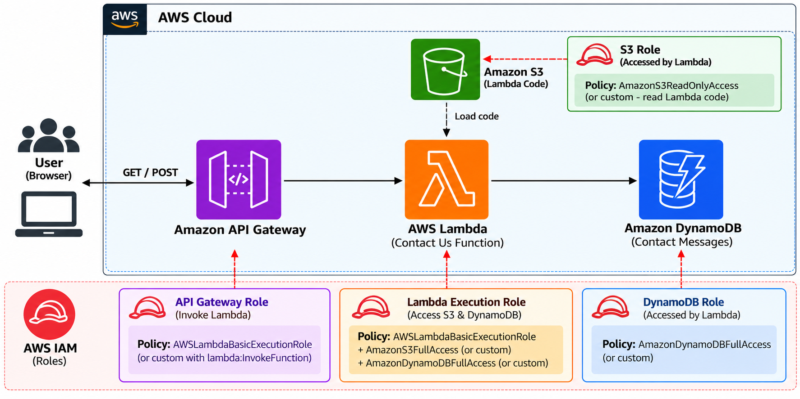

# Step-by-Step Guide: API Gateway + Lambda + DynamoDB Integration

serverless web form using API Gateway → Lambda → DynamoDB

This project explains the integration of API Gateway,Lambda,and DynamoDB to build a serverless web application

<table style="width: 100%; margin-bottom: 20px;">
  <tr>
    <td align="center" style="padding: 10px; background-color: #e9f7f5; border-radius: 8px;">
      
       <b> Lambda-DynamoDB API Integration  architecture Project </b>
    </td>
  </tr>
</table>

